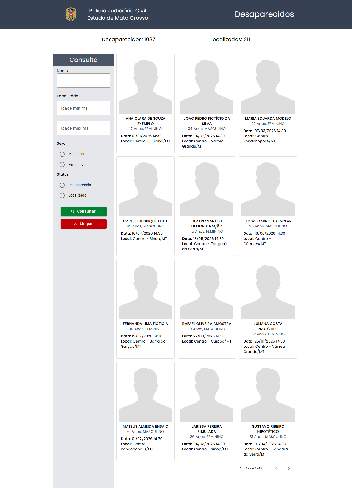

# Projeto Desaparecidos

[](https://github.com/biduco07/ProjetoDesaparecidos/actions/workflows/ci.yml)

Aplicação web para consulta de pessoas desaparecidas e localizadas no estado de Mato Grosso, consumindo a API pública **Abitus** da Polícia Judiciária Civil de MT. Permite buscar registros com filtros, ver os detalhes de cada caso e enviar informações sobre uma pessoa (texto, data e fotos).

Projeto desenvolvido como teste prático do **Processo Seletivo SEPLAG/MT** — vaga **Front-End Sênior**, por Pedro Henrique Veloso Silva de Melo.

**Demo:** https://biduco07.github.io/ProjetoDesaparecidos/

## Capturas de tela

<!--
  Espaço reservado para prints/GIF da aplicação. Exemplo:
  
  
-->

_Prints da listagem, dos filtros e da tela de detalhe serão adicionados aqui._

## Funcionalidades

- Totalizadores de pessoas desaparecidas e localizadas.
- Listagem em cards com paginação (12 registros por página).
- Filtros por nome, faixa etária, sexo e status (desaparecido/localizado).
- Tela de detalhe com situação do caso, local e data do desaparecimento e há quantos dias a pessoa está desaparecida.
- Formulário em diálogo para enviar informações sobre a pessoa, com máscara de data e upload de imagens.
- Renderização no servidor (Angular SSR) com pré-renderização das rotas; os dados da API são sempre buscados no navegador, então o HTML gerado no build não guarda um retrato desatualizado da lista.

## Stack

- [Angular 22](https://angular.dev/) (standalone components, `inject()`, control flow `@if`/`@for`, SSR)
- [Angular Material](https://material.angular.io/)
- [Tailwind CSS 4](https://tailwindcss.com/)
- [RxJS](https://rxjs.dev/)
- [NgxMask](https://github.com/JsDaddy/ngx-mask)
- Testes com Karma + Jasmine; lint com [angular-eslint](https://github.com/angular-eslint/angular-eslint)
- [Docker](https://www.docker.com/) + nginx para servir o build

## Arquitetura: Facade + State

O fluxo de dados da feature `desaparecidos` segue o padrão **Facade com State**, sem biblioteca externa de gerenciamento de estado:

```
Componente  ──comandos──▶  Facade  ──HTTP──▶  DesaparecidosService  ──▶  API Abitus
    ▲                        │
    └──── observables ◀── State (BehaviorSubjects)
```

- **Service** (`core/desaparecidos.service.ts`): única camada que conhece a API HTTP.
- **State** (`pages/desaparecidos/state/desaparecidos.state.ts`): fonte única da verdade da feature (lista paginada, estatísticas, paginação, filtros e pessoa selecionada), exposta como `Observable` somente leitura.
- **Facade** (`pages/desaparecidos/desaparecidos.facade.ts`): API pública da feature para os componentes. Orquestra chamadas ao serviço, atualiza o state e trata erros/navegação.
- **Componentes** apenas disparam comandos na facade e se inscrevem nos observables; não acessam o serviço nem o state diretamente.

Isso mantém os componentes simples, concentra regras de negócio em um único ponto e facilita testar cada camada isoladamente.

## Estrutura de pastas

```
src/
  app/
    core/                       # serviços globais (API Abitus, alertas)
    pages/
      desaparecidos/
        components/             # tela de detalhe e diálogo de envio de informações
        containers/             # página de listagem e filtros
        models/                 # interfaces de domínio
        state/                  # DesaparecidosState (BehaviorSubjects)
        desaparecidos.facade.ts # Facade da feature
    shared/
      paginacao/                # modelos de paginação
  assets/
  environments/                 # configuração por ambiente (URL da API)
```

## Como rodar

Pré-requisitos: **Node.js 22 (LTS)** e npm.

> **Atenção à versão do Node:** o Angular 22 exige Node **22.22.3 ou mais novo** na linha 22 (também aceita 24.15+ e 26+). A versão do projeto está fixada no [`.nvmrc`](.nvmrc) e no campo `engines` do `package.json` (o npm avisa com `EBADENGINE` se a versão for outra). Com nvm/fnm, rode `nvm use` (ou `fnm use`) na raiz do projeto. A CI e o Docker usam a mesma versão.

```sh
git clone https://github.com/biduco07/ProjetoDesaparecidos.git
cd ProjetoDesaparecidos
npm ci
npm start
```

A aplicação fica disponível em `http://localhost:4200/`.

### Scripts

| Comando               | Descrição                                           |
| --------------------- | --------------------------------------------------- |
| `npm start`           | Servidor de desenvolvimento                         |
| `npm test`            | Testes unitários (Karma + Jasmine) em modo watch    |
| `npm run test:ci`     | Testes uma única vez em Chrome headless             |
| `npm run lint`        | ESLint com as regras do angular-eslint              |
| `npm run build`       | Build de produção em `dist/projeto-desaparecidos`   |
| `npm run build:pages` | Build de produção da demo em `docs/` (GitHub Pages) |

### Qualidade e CI

O workflow [`.github/workflows/ci.yml`](.github/workflows/ci.yml) roda em todo push para `main`/`dev` e em pull requests: `npm ci`, lint, testes em Chrome headless e build de produção.

Os testes cobrem o `DesaparecidosService` (URLs e parâmetros com `HttpTestingController`), a facade e o state (carregamento, paginação, filtros, detalhe e envio de informações) e os componentes principais.

### Docker

O `Dockerfile` é multi-stage: a primeira etapa (Node) instala as dependências com `npm ci` e gera o build; a segunda (`nginx:alpine`) serve apenas os arquivos estáticos com o `nginx.conf` do projeto. Não é preciso ter Node instalado na máquina.

```sh
docker build -t projeto-desaparecidos .
docker run -d -p 8080:80 --name projeto-desaparecidos projeto-desaparecidos
```

A aplicação fica disponível em `http://localhost:8080/`.

### Publicação da demo (GitHub Pages)

A demo em https://biduco07.github.io/ProjetoDesaparecidos/ é servida pelo GitHub Pages a partir da pasta [`docs/`](docs) do branch `main`. Para atualizá-la:

```sh
npm run build:pages   # apaga e regenera docs/ com o build de produção
git add docs
git commit -m "build(pages): regenera docs/"
```

Depois do merge em `main`, o Pages republica sozinho em alguns minutos.

O script usa a configuração `pages` do `angular.json` (`outputMode: "static"`, arquivos do navegador direto em `docs/`, sem a pasta `server`) e `--base-href /ProjetoDesaparecidos/`, o subcaminho do repositório no Pages. Não é preciso `404.html` nem `.nojekyll`: as duas rotas (`/` e `/detalhe`) são pré-renderizadas como `index.html` e `detalhe/index.html`, e nenhum arquivo gerado começa com `_` (o que o Jekyll do Pages ignoraria).
