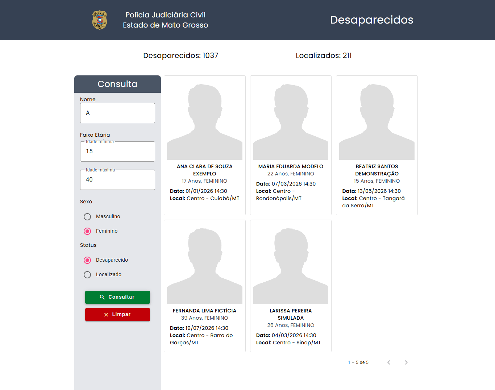
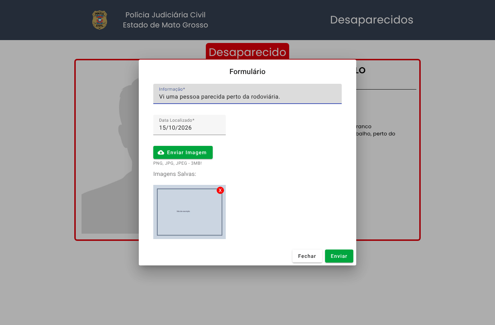
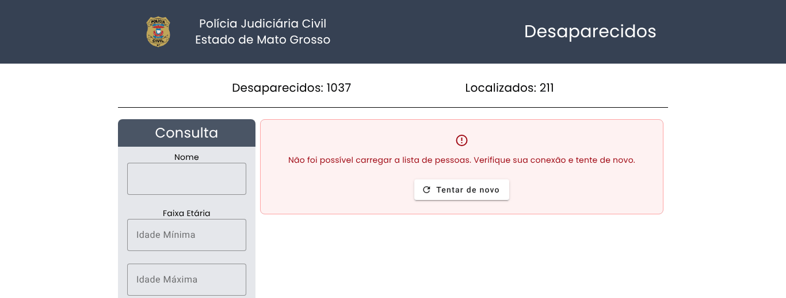
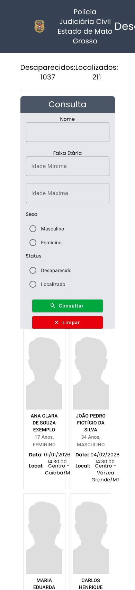
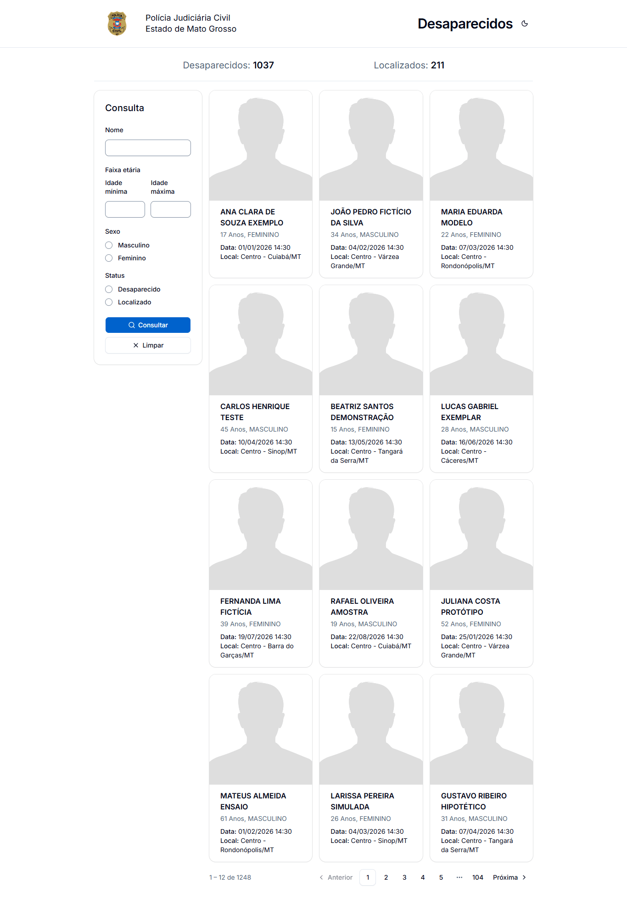
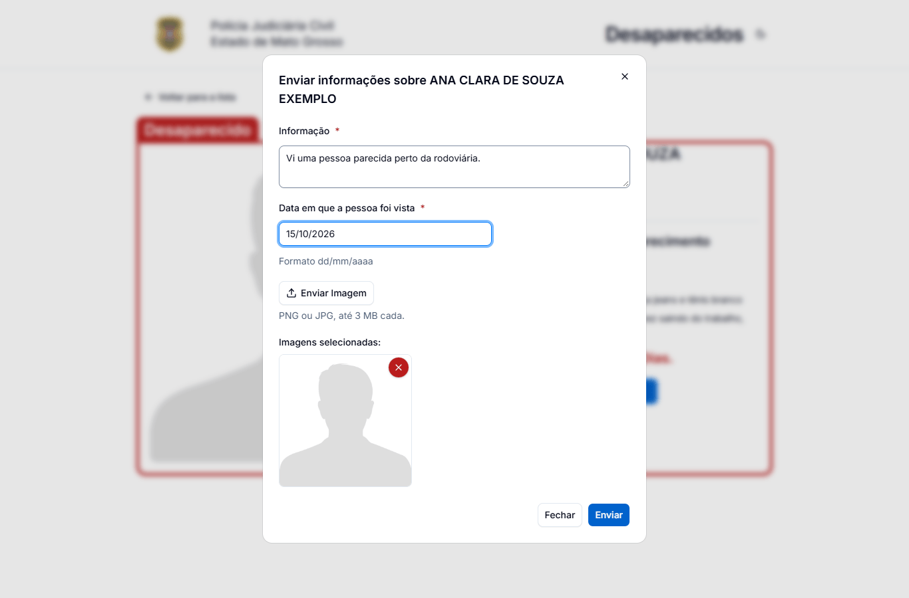

# Projeto Desaparecidos

[](https://github.com/biduco07/ProjetoDesaparecidos/actions/workflows/ci.yml)

Aplicação web para consulta de pessoas desaparecidas e localizadas no estado de Mato Grosso, consumindo a API pública **Abitus** da Polícia Judiciária Civil de MT. Permite buscar registros com filtros, ver os detalhes de cada caso e enviar informações sobre uma pessoa (texto, data e fotos).

Projeto desenvolvido como teste prático do **Processo Seletivo SEPLAG/MT** — vaga **Front-End Sênior**, por Pedro Henrique Veloso Silva de Melo.

**Demo:** https://biduco07.github.io/ProjetoDesaparecidos/

## Capturas de tela

| Listagem com totalizadores | Filtros aplicados |
| --- | --- |
| [](screenshots/listagem.png) | [](screenshots/filtros.png) |

| Tela de detalhe | Envio de informações |
| --- | --- |
| [](screenshots/detalhe.png) | [](screenshots/dialogo-informacoes.png) |

| Erro com "Tentar de novo" | Mobile (listagem e detalhe) |
| --- | --- |
| [](screenshots/erro.png) | [](screenshots/mobile-listagem.png) [](screenshots/mobile-detalhe.png) |

| Tema claro (listagem) | Tema claro (envio de informações) |
| --- | --- |
| [](screenshots/migracao-spartan/depois-claro-listagem.png) | [](screenshots/migracao-spartan/depois-claro-dialogo-informacoes.png) |

> O app abre no tema escuro; o botão sol/lua do cabeçalho troca para o claro. As capturas de antes e depois da troca do Angular Material pela spartan/ui estão em [`screenshots/migracao-spartan/`](screenshots/migracao-spartan).
>
> As capturas usam **dados fictícios**: o script [`scripts/capturas-de-tela.mjs`](scripts/capturas-de-tela.mjs) roda o app de verdade no Chromium (Playwright) e simula as respostas da API Abitus, para não expor dados de pessoas reais e não enviar nada à polícia. Veja [Como gerar as capturas](#como-gerar-as-capturas-de-tela).

## Funcionalidades

- Totalizadores de pessoas desaparecidas e localizadas.
- Listagem em cards com paginação (12 registros por página).
- Filtros por nome, faixa etária, sexo e status (desaparecido/localizado).
- Tela de detalhe com situação do caso, local e data do desaparecimento e há quantos dias a pessoa está desaparecida.
- Se a API falhar, a lista e a tela de detalhe mostram uma mensagem amigável com o botão "Tentar de novo".
- Formulário em diálogo para enviar informações sobre a pessoa, com máscara de data e upload de imagens. A data é validada de verdade (recusa 31/02 e datas futuras) e as imagens precisam ser PNG/JPG de até 3 MB.
- Acessível (WCAG 2.1 AA): tudo funciona pelo teclado, link "Pular para o conteúdo", foco levado ao conteúdo quando a rota muda, título da aba por página, resultado da busca e página da lista anunciados para leitores de tela, erros do formulário ligados aos campos e contraste de 4,5:1 (inclusive no botão com o mouse em cima). O axe-core não aponta violações nas cinco telas, no tema escuro e no claro, no desktop e no celular ([`scripts/acessibilidade.mjs`](scripts/acessibilidade.mjs)).
- Tema escuro (padrão) e claro, com o botão sol/lua no cabeçalho; a escolha fica salva no navegador.
- Renderização no servidor (Angular SSR) com pré-renderização das rotas; os dados da API são sempre buscados no navegador, então o HTML gerado no build não guarda um retrato desatualizado da lista.

## Requisitos do teste e onde estão atendidos

| Requisito                                         | Como foi atendido                                                                                                                                  |
| ------------------------------------------------- | -------------------------------------------------------------------------------------------------------------------------------------------------- |
| Consumir a API pública Abitus                      | `DesaparecidosService` (`/v1/pessoas/aberto/filtro`, `/v1/pessoas/{id}`, `/v1/pessoas/aberto/estatistico` e `POST /v1/ocorrencias/informacoes-desaparecido`) |
| Listagem em cards com foto e dados da pessoa       | Cartões da spartan/ui com foto (ou imagem padrão), nome, idade, sexo, data e local do desaparecimento                                              |
| Paginação                                         | Paginador próprio (`app-paginador`) com 12 registros por página, reticências e a página anunciada ao leitor de tela; paginação feita pela própria API |
| Busca e filtros                                   | Nome, faixa etária, sexo e status; "Limpar" volta à consulta inicial                                                                              |
| Detalhe com destaque da situação                   | Faixa e borda vermelhas (desaparecido) ou verdes (localizado), dados da ocorrência e dias desde o desaparecimento                                  |
| Envio de informações sobre a pessoa                | Diálogo com informação, data com máscara (`ngx-mask`) e várias imagens com pré-visualização, enviado como `multipart/form-data`                    |
| Rotas com carregamento sob demanda (lazy loading) | `loadComponent` nas rotas `/` e `/detalhe` (`app.routes.ts`)                                                                                       |
| Layout responsivo                                 | Tailwind: no celular, filtros acima da lista e 1 coluna de cards (2 a partir de 640 px); no desktop, filtros na lateral e 3 colunas                                    |
| Tratamento de erros                               | Mensagem amigável com "Tentar de novo" na lista e no detalhe; aviso (toast do sonner) no envio de informações                                            |
| Testes unitários                                  | 135 testes em 11 arquivos (Vitest), cobertura de linhas de ~95% (contando os componentes da spartan em `libs/ui/`), rodando na CI a cada push e PR                                                                                   |
| Empacotamento em contêiner                        | `Dockerfile` multi-stage (build com Node, servido por nginx)                                                                                       |
| README com instruções                             | Este arquivo: [como rodar](#como-rodar), [como testar](#como-testar) e [decisões técnicas](#decisões-técnicas)                                     |

## Stack

- [Angular 22](https://angular.dev/) (standalone components, `inject()`, control flow `@if`/`@for`, SSR)
- [spartan/ui](https://spartan.ng/) 1.8 (estilo `vega`), com o tema NuvyTech (repositório nuvy-ui, privado): escuro por padrão, fonte [Inter](https://rsms.me/inter/) servida pelo próprio site e ícones [Lucide](https://lucide.dev/) (`@ng-icons/lucide`)
- [Tailwind CSS 4](https://tailwindcss.com/)
- [RxJS](https://rxjs.dev/)
- [NgxMask](https://github.com/JsDaddy/ngx-mask)
- Testes com [Vitest](https://vitest.dev/) + jsdom (builder `@angular/build:unit-test`); lint com [angular-eslint](https://github.com/angular-eslint/angular-eslint)
- [Docker](https://www.docker.com/) + nginx para servir o build

## Arquitetura: Facade + State

O fluxo de dados da feature `desaparecidos` segue o padrão **Facade com State**, sem biblioteca externa de gerenciamento de estado:

```
Componente  ──comandos──▶  Facade  ──HTTP──▶  DesaparecidosService  ──▶  API Abitus
    ▲                        │
    └──── observables ◀── State (BehaviorSubjects)
```

- **Service** (`core/desaparecidos.service.ts`): única camada que conhece a API HTTP.
- **State** (`pages/desaparecidos/state/desaparecidos.state.ts`): fonte única da verdade da feature (lista paginada, estatísticas, paginação, filtros e pessoa selecionada), exposta como `Observable` somente leitura.
- **Facade** (`pages/desaparecidos/desaparecidos.facade.ts`): API pública da feature para os componentes. Orquestra chamadas ao serviço, atualiza o state e trata erros/navegação.
- **Componentes** apenas disparam comandos na facade e se inscrevem nos observables; não acessam o serviço nem o state diretamente.

Isso mantém os componentes simples, concentra regras de negócio em um único ponto e facilita testar cada camada isoladamente.

## Decisões técnicas

- **Facade + State com RxJS em vez de NgRx/NGXS:** a feature tem um único fluxo (lista, filtros, detalhe). `BehaviorSubject`s numa classe de state dão a mesma separação sem o custo de actions/reducers.
- **Standalone components, `inject()` e signals com `OnPush`:** os componentes convertem os observables da facade em signals (`toSignal`) e usam detecção de mudanças `OnPush`, o que evita verificações desnecessárias.
- **SSR com pré-renderização, mas sem dados da API no servidor:** o HTML das rotas é gerado no build (primeira pintura rápida e boa para SEO), mas a facade só chama a API no navegador. Assim a lista nunca fica congelada no HTML do build.
- **Filtros opcionais fora da query string quando vazios:** `sexo` e `status` só são enviados quando escolhidos, para não mandar `undefined`/`null` como texto para a API.
- **Erro com nova tentativa no lugar da tela:** se a lista ou o detalhe falham, a área de conteúdo mostra a mensagem e o botão "Tentar de novo", que repete a mesma consulta (mesma página e filtros).
- **Vitest + jsdom em vez de Karma:** os testes rodam sem abrir navegador, mais rápido na máquina e na CI, com o builder oficial `@angular/build:unit-test`.
- **Cards com um botão de verdade dentro:** o card inteiro continua clicável, mas o nome da pessoa é um `<button>`, para o card abrir pelo teclado e ser anunciado corretamente por leitores de tela.
- **nginx com cabeçalhos de segurança e cache por tipo de arquivo:** CSP, `X-Frame-Options` e `nosniff`; JS/CSS com hash ficam em cache por 1 ano e o HTML nunca fica em cache, então um deploy novo chega na hora.
- **spartan/ui com o tema NuvyTech no lugar do Angular Material:** os componentes "helm" da spartan são copiados para [`libs/ui/`](libs/ui) (o código fica no projeto, como no shadcn/ui) e usam os tokens do tema ([`src/styles/nuvy-tema.css`](src/styles/nuvy-tema.css), cópia do nuvy-ui). Os templates só usam tokens (`bg-primary`, `text-destructive`, `text-muted-foreground`...), então o claro e o escuro funcionam sozinhos; os testes falham se aparecer uma cor fixa do Tailwind.
- **Paginador próprio:** a paginação da spartan é só visual e navega por `routerLink`; aqui a página fica no state. O `app-paginador` calcula a janela (primeira, última, a atual com as vizinhas e reticências), usa rótulos em português e anuncia "Página N de M".
- **Bundle inicial enxuto (~443 kB; era 590 kB antes do PR #12):** o `ngx-mask` é registrado só no diálogo que usa a máscara, e o toaster dos avisos carrega num `@defer (on idle)`. O botão de tema do cabeçalho usa as classes do `hlmBtn` sem a diretiva: ela traria o `tailwind-merge` e o overlay do CDK para o bundle inicial.
- **Demo estática no GitHub Pages:** a configuração `pages` gera só os arquivos do navegador em `docs/`, sem precisar de servidor Node.

## Estrutura de pastas

```
src/
  app/
    core/                       # serviços globais (API Abitus, alertas)
    pages/
      desaparecidos/
        components/             # tela de detalhe e diálogo de envio de informações
        containers/             # página de listagem e filtros
        models/                 # interfaces de domínio
        state/                  # DesaparecidosState (BehaviorSubjects)
        desaparecidos.facade.ts # Facade da feature
    shared/
      paginacao/                # modelos de paginação e o paginador próprio
  assets/
  styles/nuvy-tema.css          # tema NuvyTech (cópia do nuvy-ui; não edite aqui)
libs/ui/                        # componentes helm da spartan/ui (gerados pelo CLI)
public/nuvy-tema.js             # põe o escuro antes da primeira pintura
  environments/                 # configuração por ambiente (URL da API)
scripts/                        # script que gera as capturas de tela
screenshots/                    # capturas usadas neste README
docs/                           # build da demo publicada no GitHub Pages
```

## Tema e componentes (spartan/ui)

- **Tema:** [`src/styles/nuvy-tema.css`](src/styles/nuvy-tema.css) é uma cópia do tema NuvyTech do repositório nuvy-ui. Para atualizar, rode `npm run copiar -- <pasta deste projeto>` dentro do nuvy-ui e abra um PR com o arquivo novo. Não edite a cópia à mão.
- **Escuro e claro:** [`public/nuvy-tema.js`](public/nuvy-tema.js), no `<head>`, põe a classe `.dark` no `<html>` antes da primeira pintura (escuro por padrão). O [`TemaService`](src/app/core/tema.service.ts) liga o botão do cabeçalho e grava a escolha no `localStorage` (chave `nuvy-tema`); no servidor ele não mexe no DOM.
- **Componentes:** os da spartan ficam em [`libs/ui/`](libs/ui) e são importados por `@spartan-ng/helm/<nome>` (caminhos no `tsconfig.json`). O estilo (`vega`) e a pasta estão no [`components.json`](components.json). Para gerar outro componente, sem deixar o CLI (que traz o Nx) no `package.json`:

  ```sh
  npm i --no-save @spartan-ng/cli@1.8.0
  npx ng g @spartan-ng/cli:ui <nome>   # ex.: select, tooltip
  ```

  O CLI cria a pasta `.nx/` (ignorada pelo git). Não rode o `ng g @spartan-ng/cli:init` nem o `ui-theme`: eles gravam no `styles.css` cores que passam por cima do tema.

## Como rodar

Pré-requisitos: **Node.js 22 (LTS)** e npm.

> **Atenção à versão do Node:** o Angular 22 exige Node **22.22.3 ou mais novo** na linha 22 (também aceita 24.15+ e 26+). A versão do projeto está fixada no [`.nvmrc`](.nvmrc) e no campo `engines` do `package.json` (o npm avisa com `EBADENGINE` se a versão for outra). Com nvm/fnm, rode `nvm use` (ou `fnm use`) na raiz do projeto. A CI e o Docker usam a mesma versão.

```sh
git clone https://github.com/biduco07/ProjetoDesaparecidos.git
cd ProjetoDesaparecidos
npm ci
npm start
```

A aplicação fica disponível em `http://localhost:4200/`. Ela chama a API Abitus direto do navegador (`src/environments/`), então precisa de acesso à internet.

### Com SSR (build de produção)

```sh
npm run build
npm run serve:ssr:ProjetoDesaparecidos
```

O servidor Express do Angular SSR sobe em `http://localhost:4000/` (porta configurável com `PORT`).

### Scripts

| Comando                                  | Descrição                                           |
| ---------------------------------------- | --------------------------------------------------- |
| `npm start`                              | Servidor de desenvolvimento                         |
| `npm test`                               | Testes unitários (Vitest) em modo watch             |
| `npm run test:ci`                        | Testes uma única vez (jsdom, sem abrir navegador)   |
| `npm run test:coverage`                  | Testes com relatório de cobertura em `coverage/`    |
| `npm run lint`                           | ESLint com as regras do angular-eslint              |
| `npm run build`                          | Build de produção em `dist/projeto-desaparecidos`   |
| `npm run serve:ssr:ProjetoDesaparecidos` | Serve o build de produção com SSR                   |
| `npm run build:pages`                    | Build de produção da demo em `docs/` (GitHub Pages) |

## Como testar

### Verificações automáticas

```sh
npm run lint      # ESLint (angular-eslint)
npm run test:ci   # 135 testes unitários com Vitest + jsdom
npm run build     # build de produção com SSR e pré-renderização
```

São os mesmos passos da CI. O build termina sem avisos: o bundle inicial tem ~443 kB (cerca de 117 kB transferidos com compressão), dentro do orçamento de 500 kB do `angular.json` (o build falha acima de 550 kB, para um import que traga o overlay do CDK de volta não passar em silêncio).

### Roteiro manual

1. Abra a [demo](https://biduco07.github.io/ProjetoDesaparecidos/) ou rode `npm start`.
2. Confira os totalizadores no topo e navegue entre as páginas da lista.
3. Filtre por nome, faixa etária, sexo e status e clique em **Consultar**; **Limpar** volta à lista completa.
4. Clique num card para abrir o detalhe (faixa vermelha para desaparecido, verde para localizado).
5. Numa pessoa desaparecida, clique em **Encontrou Essa Pessoa?** para abrir o formulário. Atenção: **Enviar** manda a informação de verdade para a API da Polícia Civil; para testar sem enviar, use **Fechar**.
6. Para ver o estado de erro, bloqueie a API no DevTools (aba Network, *Block request domain* `abitus-api.geia.vip`) e recarregue: aparece a mensagem com **Tentar de novo**.
7. Para o layout mobile, use o modo de dispositivo do DevTools (ex.: 390 × 844).

### Como gerar as capturas de tela

As imagens de [`screenshots/`](screenshots) são geradas pelo [`scripts/capturas-de-tela.mjs`](scripts/capturas-de-tela.mjs), que abre o app no Chromium com o Playwright e simula a API Abitus com dados fictícios (nada é enviado à API real). O Playwright não é dependência do projeto; instale-o só para isso:

```sh
npm i --no-save playwright && npx playwright install chromium
npm start   # em outro terminal
node scripts/capturas-de-tela.mjs http://localhost:4200/ screenshots
```

Para usar o Edge ou o Chrome já instalados em vez de baixar o Chromium, defina `PW_CHANNEL=msedge` (ou `chrome`) antes do último comando. `CAPTURA_TEMA=escuro` (ou `claro`) escolhe o tema e `CAPTURA_PREFIXO=depois-escuro-` muda o nome dos arquivos; foi assim que saíram as capturas de [`screenshots/migracao-spartan/`](screenshots/migracao-spartan).

Os PNGs versionados foram reduzidos para paleta de 256 cores (menos da metade do tamanho) depois de gerados:

```sh
npm i --no-save sharp
node -e "const s=require('sharp'),fs=require('fs');for(const d of ['screenshots/','screenshots/migracao-spartan/'])for(const f of fs.readdirSync(d)){if(!f.endsWith('.png'))continue;const p=d+f;s(p).png({palette:true,colors:256,compressionLevel:9}).toBuffer().then(b=>fs.writeFileSync(p,b))}"
```

### Acessibilidade (axe)

O [`scripts/acessibilidade.mjs`](scripts/acessibilidade.mjs) usa a mesma API simulada e roda o axe-core (regras WCAG 2.0 e 2.1, níveis A e AA) na listagem, nos filtros, no detalhe, no diálogo, no aviso de erro e na tela de erro, no tema escuro e no claro, no desktop e no celular. Também mede o contraste do texto do botão principal parado e com o mouse em cima. Sai com erro se achar alguma violação ou contraste abaixo de 4,5:1.

```sh
npm i --no-save playwright @axe-core/playwright && npx playwright install chromium
npm run build && npm run serve:ssr:ProjetoDesaparecidos   # em outro terminal
node scripts/acessibilidade.mjs http://localhost:4000/
```

### Qualidade e CI

O workflow [`.github/workflows/ci.yml`](.github/workflows/ci.yml) roda em todo push para `main`/`dev` e em pull requests: `npm ci`, lint, testes (Vitest) e build de produção.

Os testes cobrem o `DesaparecidosService` (URLs e parâmetros com `HttpTestingController`), a facade e o state (carregamento, paginação, filtros, detalhe e envio de informações), os componentes principais (incluindo validação do formulário, teclado e atributos de acessibilidade), o paginador (janela de páginas, rótulos e anúncio), o serviço de tema e a ausência de cores fixas do Tailwind nos templates.

## Docker

O `Dockerfile` é multi-stage: a primeira etapa (Node) instala as dependências com `npm ci` e gera o build; a segunda (`nginx:stable-alpine`) serve apenas os arquivos estáticos com a configuração da pasta [`nginx/`](nginx): cabeçalhos de segurança (CSP, `X-Frame-Options`, `nosniff` etc.), cache longo para JS/CSS com hash e `no-cache` para o HTML, e fallback da SPA para o `index.csr.html`. Não é preciso ter Node instalado na máquina.

```sh
docker build -t projeto-desaparecidos .
docker run -d -p 8080:80 --name projeto-desaparecidos projeto-desaparecidos
```

A aplicação fica disponível em `http://localhost:8080/`.

## Publicação da demo (GitHub Pages)

A demo em https://biduco07.github.io/ProjetoDesaparecidos/ é servida pelo GitHub Pages a partir da pasta [`docs/`](docs) do branch `main`. Para atualizá-la:

```sh
npm run build:pages   # apaga e regenera docs/ com o build de produção
git add docs
git commit -m "build(pages): regenera docs/"
```

Depois do merge em `main`, o Pages republica sozinho em alguns minutos.

O script usa a configuração `pages` do `angular.json` (`outputMode: "static"`, arquivos do navegador direto em `docs/`, sem a pasta `server`) e `--base-href /ProjetoDesaparecidos/`, o subcaminho do repositório no Pages. Não é preciso `404.html` nem `.nojekyll`: as duas rotas (`/` e `/detalhe`) são pré-renderizadas como `index.html` e `detalhe/index.html`, e nenhum arquivo gerado começa com `_` (o que o Jekyll do Pages ignoraria). Como o detalhe depende da pessoa escolhida na lista, `detalhe/index.html` é só um redirecionamento para a lista (quem recarrega a página de detalhe volta para a listagem).
